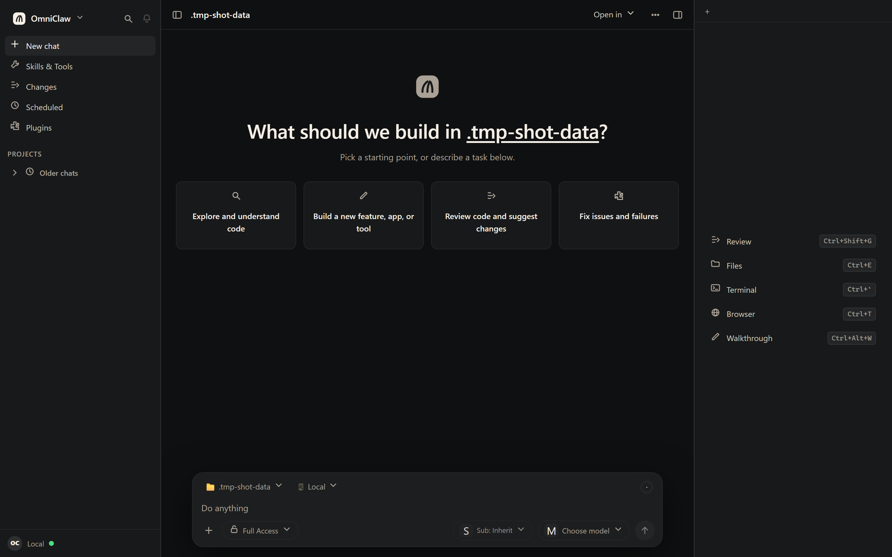
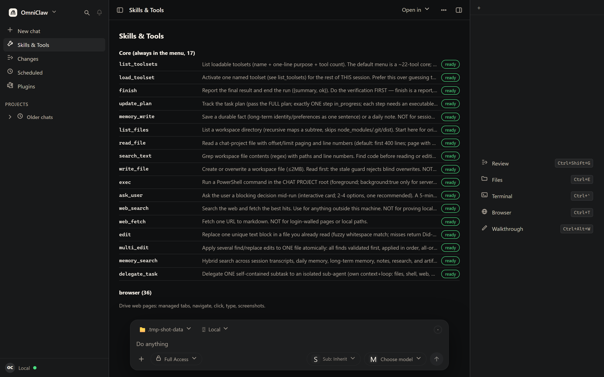
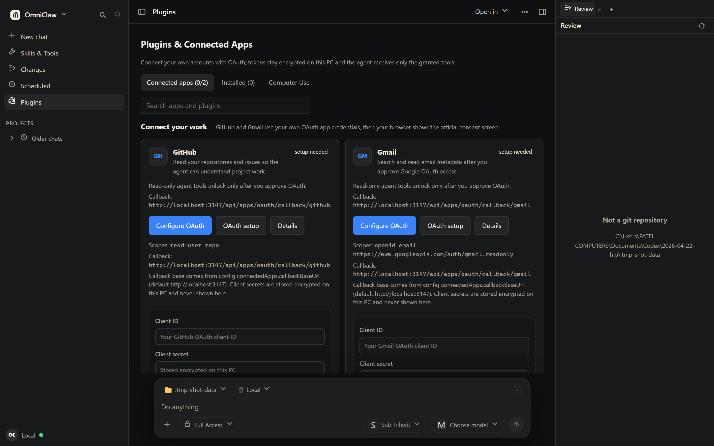
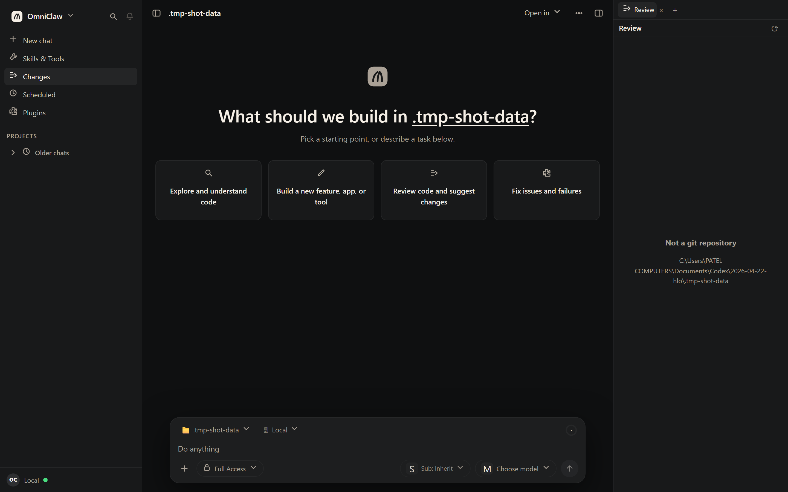
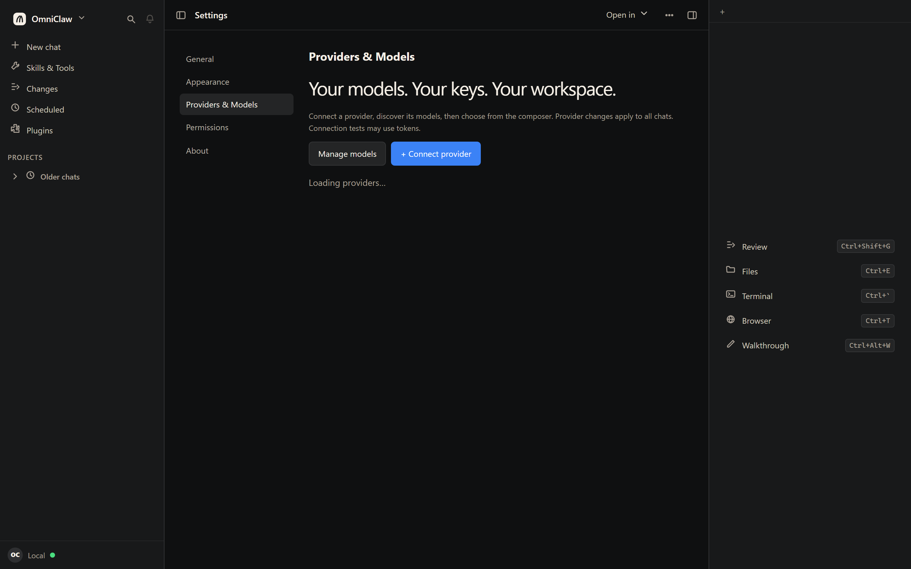

# OmniClaw

**A local-first AI agent that actually does work on your Windows machine — files, terminal, git, and the browser — not just chat.**

OmniClaw runs entirely on your own PC. It reads and writes your real project files, runs real shell commands, drives a real Chrome instance, keeps long-term memory, and asks for approval before anything risky. No cloud account. No data leaving your machine.

<!-- Screenshots: real captures of the running app, produced by
     scripts/capture-readme-shots.mjs. Nothing here is mocked. -->

## The interface



Sidebar with your projects and chats on the left, the conversation in the middle, and a work panel on the right (**Review · Files · Terminal · Browser · Walkthrough**) that opens with a keyboard shortcut. Press `Ctrl+T` and you are looking at the browser the agent is driving.

---

## Download and run (Windows)

You do **not** need Node.js, Git, or this repository.

1. Go to **[Releases](../../releases)** on the right-hand side of this page.
2. Download the `OmniClaw-Windows-*.zip` file.
3. Extract it anywhere you like (for example `C:\Apps\OmniClaw`).
4. Double-click **`OmniClaw.exe`**.

That is it. On the first run OmniClaw automatically creates an **OmniClaw shortcut on your desktop**. Double-click that shortcut any time to start the app — it starts the local server and opens your browser to the dashboard.

> **Moved the folder?** Just run `OmniClaw.exe` again. The launcher notices the desktop shortcut points at the old location and repairs it automatically.

### Requirements

| | |
|---|---|
| **OS** | Windows 10/11, 64-bit |
| **Disk** | ~250 MB extracted |
| **Node.js** | *not required* — bundled into the EXE |
| **API key** | Only if you use a cloud model (see [Configuration](#configuration)). Fully optional. |

The first launch opens `http://localhost:3147`. Everything is served from your own machine; that address is not reachable from the network.

---

## Configuration

OmniClaw needs to know which model to talk to. Open **Settings → Providers** and pick one:

- **OpenAI-compatible** (OpenRouter, Together, Groq, Ollama, LM Studio, vLLM, anything with an `/v1` API) — bring your own API key
- **Codex CLI** — reuse an existing local CLI login
- **Mock** — a local stub, useful for trying the UI with no key at all

Keys are stored in an encrypted local secret store on your machine. They are never written into the release ZIP, never logged, and never sent anywhere except the provider you chose.

---

## What it can do

### Files, terminal and git

Real access to your filesystem, scoped by an explicit computer-access policy, with every write gated behind an approval card you have to click. Read-only git inspection is always available; **mutating git sits in its own approval-gated toolset**, so the agent cannot commit on its own.

### A real browser it can see



A managed Chromium instance the agent drives end to end — navigate, click, type, evaluate, screenshot. There is a screencast view in the panel, so you watch it work instead of guessing. This is what turns "go book me a flight" from a suggestion into an action.

### Long-term memory that survives restarts

OmniClaw keeps a real memory store: notes, past conversations, promoted long-term facts, and semantic search over them. Restart the app and it still knows your project, your preferences and what you did last week.

### Skills, tools and plugins



Tools are grouped into **12 toolsets** (browser, computer, git, project, comms, memory, web, forge, MCP and more) carrying **174 tools**. The agent is handed a menu of ~30 tools matched to your request rather than the whole catalogue, so a weak model does not drown in choices. You can add your own skills and tools, and connect external MCP servers.

### Changes and review



Every edit the agent makes shows up as a real diff you can read before accepting. `Files`, `Terminal` and `Browser` panels sit alongside it.

### Multi-channel

Talk to the same agent from the dashboard, from **Telegram**, or from a scheduled task. All of it lands in the same sessions and the same memory.

### Settings



Providers, appearance, permissions and runtime configuration — all local, all editable without touching a config file by hand.

---

## How it is built

- **Runtime:** Node.js ESM, no framework, no build step for the server. HTTP is raw `node:http` with SSE for streaming.
- **Frontend:** vanilla ES modules and plain CSS. No React, no bundler, no CDN — the vendored markdown renderer and sanitizer are committed.
- **Packaging:** `@yao-pkg/pkg` produces two binaries — a small `OmniClaw.exe` launcher and an `omniclaw-gateway.exe` server — so the whole app is one folder you can copy to a USB stick.
- **Providers:** one abstraction over OpenAI-compatible endpoints, the Codex CLI, and a mock backend, with per-provider key storage and failover chains.

```
server.js              raw HTTP server + routing
src/core/agent.js      the orchestrator
src/core/omni-loop.js  the agent loop (streaming, tools, plans, budgets)
src/core/tool-registry.js   every tool the agent can call
src/core/agent-registry.js  agents, their tools and permissions
web-next/              the dashboard UI
```

---

## Building from source

You only need this if you want to change the code.

```bash
git clone https://github.com/jaatkundu90346-png/omniclaw.git
cd omniclaw
npm install

npm start                 # run the server (http://localhost:3147)
npm run build             # syntax check
npm run portable:build    # build the Windows EXE + release ZIP
```

The portable build writes `dist/windows-portable/` and a versioned ZIP into `dist/releases/`.

### Tests

```bash
npm test                       # API suite (node:test)
npm run test:omni-loop         # agent loop contract
npm run test:agent-loop        # agent loop contract
npm run test:thread-ticker-leak # no orphaned UI timers after navigation
npm run test:shortcut          # desktop shortcut is written, idempotent, self-repairing
```

---

## Privacy

- Your conversations, memory, sessions and files stay on your machine.
- The server binds to **loopback only**. It is not reachable from your network unless you explicitly opt in.
- API keys go to an encrypted local secret store, never into the release ZIP.
- The only network traffic is to the model provider you configured, and to whatever site the agent is asked to visit.

---

## Contributing

Issues and pull requests are welcome. Run `npm test` before opening a PR — the API suite and the agent-loop smokes are fast and catch most regressions.

## License

MIT. See [LICENSE](LICENSE).